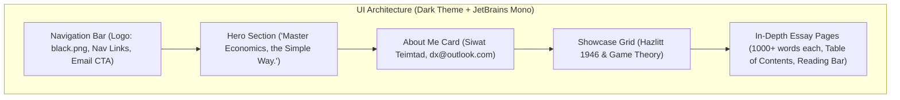

# Economist Portfolio Website: Implementation & Deployment Plan

**Author:** Siwat Teimtad  
**Email:** `dx@outlook.com`  
**Branding / Logo:** `black.png`  
**Typography:** `JetBrains Mono`  
**Theme:** Modern Dark Minimalist  
**Target Platform:** GitHub Pages  

---

## 1. Project Specifications

| Feature | Specification |
| :--- | :--- |
| **Theme & Aesthetic** | High-contrast modern dark palette (`#0d1117`, `#161b22`, `#30363d`), accented with muted slate borders and clean highlights (`#58a6ff`, `#3fb950`). |
| **Typography** | `JetBrains Mono` sourced via Google Fonts, with tuned line-heights (1.65–1.75) for long-form academic reading. |
| **Hero Section** | Centered prominent quote: *"Master Economics, the Simple Way."* accompanied by a clean subtitle introducing Siwat Teimtad as an economist. |
| **Logo** | `black.png` integrated into the site header and favicon. |
| **About / Contact** | Profile card featuring **Siwat Teimtad** and **`dx@outlook.com`** (includes one-click clipboard copy + direct `mailto:` link). |
| **Project 1** | *Key Economic Concepts of Economics in One Lesson (Henry Hazlitt, 1946)* — In-depth analytical paper (**1,000+ words**). |
| **Project 2** | *Game Theory: Foundations, Strategic Equilibria, and Economic Applications* — Rigorous academic treatise (**1,000+ words**). |

---

## 2. File & Directory Architecture

To ensure zero dependencies, maximum load speeds, and seamless compatibility with GitHub Pages:

```
my_data/
├── plan/
│   └── our_plan.md            # This project blueprint
├── index.html                 # Main landing page (Hero, About Me, Project Cards, Contact)
├── hazlitt-economics.html     # Dedicated essay page: Hazlitt's 1946 Economics (1,000+ words)
├── game-theory.html           # Dedicated essay page: Game Theory Treatise (1,000+ words)
├── style.css                  # Unified dark styling, JetBrains Mono font, responsive design
├── script.js                   # Client interactivity: reading progress bar, copy-email toast, smooth scroll
├── black.png                  # Brand logo
└── README.md                  # Repository documentation and deployment instructions
```

---

## 3. Deep-Dive Content Strategy (1,000+ Words Per Paper)

### Project 1: Henry Hazlitt's *Economics in One Lesson* (1946)
*Target: 1,100 – 1,300 words*
1. **The Axiom of the One Lesson:** Short-run versus long-run consequences; analyzing policies across all economic groups rather than concentrated special-interest beneficiaries.
2. **The Broken Window Fallacy:** The classic Bastiat-Hazlitt refutation of destructive stimulus; the unseen destruction of purchasing power and opportunity cost.
3. **Public Works and Taxation:** Deconstructing the illusion of state-created wealth; the seen infrastructure vs. the unseen diverted capital.
4. **The Fallacy of Technological Unemployment:** Historical analysis of automation, machinery, productive efficiency, and reallocated consumer surplus.
5. **Government Price Controls & Rent Restrictions:** Supply distortion, misallocation of capital, shortages, and economic degradation.
6. **Subsidies, Tariffs, and Industrial Policy:** Export subsidization fallacies, wealth transfers, and protectionism deadweight losses.
7. **Inflation as an Invisible Regressive Tax:** Purchasing power erosion, the Cantillon effect, and monetary distortion.
8. **Modern Synthesis:** Lessons for 21st-century fiscal and monetary governance.

### Project 2: Game Theory: Strategic Interactions & Economic Equilibria
*Target: 1,100 – 1,300 words*
1. **Foundations of Strategic Decision-Making:** From Von Neumann-Morgenstern to John Nash; rationality assumptions, payoffs, and information partitions.
2. **Taxonomy of Games:** Normal (matrix) vs. extensive (tree) forms; simultaneous vs. sequential decision rules; backward induction.
3. **Dominant Strategies & The Prisoner’s Dilemma:** Individual rationality vs. collective optimality; payoff matrices, Pareto inefficiency, and real-world economic parallels (OPEC cartels, pricing wars, common-pool resources).
4. **Nash Equilibrium:** Pure strategies, mixed strategies, mathematical definitions, existence theorem, and multi-equilibrium coordination dilemmas.
5. **Repeated Games and the Folk Theorem:** Infinite horizons, trigger strategies, grim triggers, Tit-for-Tat, and sustaining cooperation in market competition.
6. **Information Economics & Signaling:** Asymmetric information, George Akerlof's Market for Lemons, Michael Spence’s labor market signaling models, and screening mechanisms.
7. **Mechanism Design & Auction Theory:** Vickrey auctions, second-price dynamics, incentive compatibility, and spectrum allocation.
8. **Modern Economic Applications:** Central bank forward guidance, oligopoly competition (Cournot vs. Bertrand), and digital platform mechanics.

---

## 4. UI & Visual Design System



### Color Palette & Typography
- **Canvas / Background:** `#0d1117`
- **Surface / Card Background:** `#161b22`
- **Border / Divider:** `#30363d`
- **Primary Text:** `#e6edf3`
- **Muted Text:** `#8b949e`
- **Accent Blue:** `#58a6ff`
- **Accent Emerald:** `#3fb950`
- **Font:** `'JetBrains Mono', monospace` (imported via Google Fonts)

---

## 5. Step-by-Step Implementation Steps

### Phase 1: Core Layout & Styling
1. Create `style.css` with responsive CSS variables, dark theme tokens, and typography.
2. Create `black.png` placeholder logo (ready for your custom logo).
3. Build `index.html`:
   - Fixed header with `black.png` logo and navigation.
   - Hero section featuring *"Master Economics, the Simple Way."*
   - About section displaying **Siwat Teimtad** and **`dx@outlook.com`** with a copy button.
   - Featured Project Cards linking to full reading pages.

### Phase 2: Authoring the In-Depth Essays
1. Build `hazlitt-economics.html` with the full 1,000+ word Hazlitt analysis, table of contents, and key takeaways.
2. Build `game-theory.html` with the full 1,000+ word Game Theory paper, payoff matrices, diagrams, and applications.

### Phase 3: Interactive Features (`script.js`)
1. Reading progress bar tracking scroll on long-form articles.
2. One-click "Copy Email" with instant clipboard interaction.
3. Smooth scrolling for internal anchor links.

---

## 6. Deployment on GitHub Pages

### Method A: Direct Browser Upload (Fastest, No Git Install Required)
1. Log in to [GitHub](https://github.com) &rarr; **New repository** &rarr; Name it (e.g., `siwat-portfolio`).
2. Set visibility to **Public** and check **Add a README file** &rarr; click **Create repository**.
3. Click **Add file** &rarr; **Upload files**.
4. Drag and drop `index.html`, `hazlitt-economics.html`, `game-theory.html`, `style.css`, `script.js`, and `black.png`.
5. Click **Commit changes**.
6. Go to **Settings** &rarr; **Pages** &rarr; Under **Build and deployment**, select **Deploy from a branch** &rarr; choose `main` branch and `/(root)` &rarr; click **Save**.
7. In 1–2 minutes, your website will be live at:
   `https://<your-username>.github.io/siwat-portfolio/`

### Method B: Using Git CLI (Once Git is installed)
```powershell
git init
git add .
git commit -m "Deploy Siwat Teimtad portfolio"
git branch -M main
git remote add origin https://github.com/<your-username>/<your-repo-name>.git
git push -u origin main
```
Then enable GitHub Pages under repository Settings.
